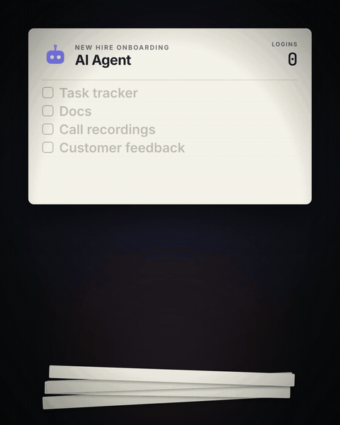

# Dutify MCP server

One hosted MCP server for the whole [Dutify](https://dutify.ai) suite. Nothing to install: point your MCP client at the URL and pass an API key.



```
https://mcp.dutify.ai
```

Transport: Streamable HTTP. Auth: `X-API-Key` header.

## What your agent can do

189 tools across four products:

| Product | Tools | What they cover |
|---|---|---|
| [Dutify Cloud](https://dutify.cloud) (project management) | `pm_*` (107) | Tasks, subtasks, comments, sprints, views, custom fields, tags, time tracking, automations, webhooks |
| [Dutify Hub](https://hub.dutify.ai) (calls) | `hub_*` (32) | Call recordings, transcripts, summaries, search, Lens chat over your calls, send call items to Jira / ClickUp / Airtable |
| [Codexum](https://codexum.ai) (wiki) | `wiki_*` (24) | Spaces, pages, search, attachments, public sharing |
| [Roadmarq](https://roadmarq.ai) (feature requests) | `fr_*` (18) | Feature requests, bugs, votes, comments, statuses |

Plus discovery tools: `whoami`, `list_workspaces`, `find_my_workspace`, `list_accounts`, `list_spaces`, `list_boards`, `get_api_catalog`, `get_endpoint_examples`.

The backend enforces your key's scopes and your current workspace permissions on every call. The tool list is visible without a key; every data call needs one.

## Get a key

1. Sign up free at [dutify.cloud](https://dutify.cloud) (or [hub.dutify.ai](https://hub.dutify.ai) for Hub).
2. Create a **personal key** (`du_live_…`) in your account settings. It works across every product you have access to.

Workspace keys also work: `dk_live_…` (Cloud, Codexum, Roadmarq only) and `dh_live_…` (Hub only).

## Connect

### Claude Code

```bash
claude mcp add --transport http dutify https://mcp.dutify.ai --header "X-API-Key: du_live_YOUR_KEY"
```

### Cursor (`~/.cursor/mcp.json`), Claude Desktop and other JSON-config clients

```json
{
  "mcpServers": {
    "dutify": {
      "url": "https://mcp.dutify.ai",
      "headers": { "X-API-Key": "du_live_YOUR_KEY" }
    }
  }
}
```

### Cline (`cline_mcp_settings.json`)

```json
{
  "mcpServers": {
    "dutify": {
      "type": "streamableHttp",
      "url": "https://mcp.dutify.ai",
      "headers": { "X-API-Key": "du_live_YOUR_KEY" }
    }
  }
}
```

### VS Code (`.vscode/mcp.json`)

```json
{
  "servers": {
    "dutify": {
      "type": "http",
      "url": "https://mcp.dutify.ai",
      "headers": { "X-API-Key": "du_live_YOUR_KEY" }
    }
  }
}
```

## First call

Ask your agent to run `whoami`, then `list_workspaces`. Pass the workspace on each data call, or set a default with an `X-Dutify-Workspace` header (identifier or name).

## Related

- [dutify-cloud-ai-skill](https://github.com/dutifyai/dutify-cloud-ai-skill): Claude Code skill for calling the same products over plain HTTP.
- Official MCP Registry: `io.github.dutifyai/dutify`

## Support

support@dutify.ai
